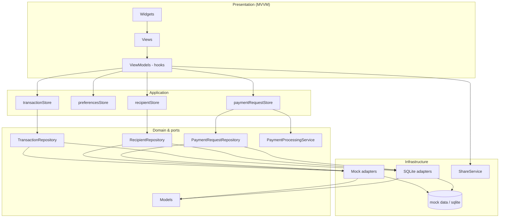

# AEON Bank Transactions

Mobile engineer assessment project: an Expo/React Native banking MVP for browsing, filtering, and sharing transaction history, plus recipients, payments, and budget insights. The app uses mock / local SQLite data today, with architecture shaped for a future authenticated API and hardened production controls.

See also **[CODE_REVIEW.md](CODE_REVIEW.md)** for architecture/security findings, assignment checklist detail, and the production backlog.

## Features

- **Navigation** — React Navigation **drawer** (settings from the right) + **bottom tabs** (Transactions | Recipients | Budget) + **native stacks** per tab. Profile avatar opens profile; settings gear opens the drawer.
- **Local persistent database** — On **iOS / Android**, transactions, recipients, and payment requests persist via **expo-sqlite** (repository adapters under `src/repositories/` + schema helpers in `src/data/sqlite/`). **Web** uses the in-memory **mock** repository path (SQLite is native-only). Bootstrap can fall back to mocks if native DB init fails (logged + visible banner).
- **Balance & profile** — Available balance and greeting; profile uses first name, last name, and DOB as **Day / Month / Year** fields with auto-advance.
- **Balance product rule** — **Available / spendable** = sum of **completed** transactions only. **Scheduled outgoing** is reserved against available for affordability checks. **Pending incoming** (e.g. request money) is shown separately and is **not spendable** until settled.
- **Recipients** — Saved payees; **Send** (amount-only, send now or one-time schedule) and **Request** money (creates a **pending** income transaction); scheduled list (view/cancel); pending requests with exercise-only **Mark as paid** / cancel (simulated settle — see below).
- **Transaction list** — Latest-first sorting with **sticky day headers**; tap a row to open detail by `refId`. A floating **action FAB** opens Transfer or Request (recipient picker).
- **Detail screen** — Full transfer metadata with formatted currency, dates, and **category**.
- **Pay / request (Transactions tab)** — Use the **+ FAB** for Transfer or Request; opens the recipient picker with the matching mode.
- **Categories** — Salary, transfer, food, entertainment, bills, personal, transportation, and other/unknown; filter the list by category and edit category on detail where supported.
- **Share** — Native share sheet via `ShareService`, with receipt text built from domain data and passed through `sanitizeSharePayload`.
- **Search & filters**
  - Debounced search (~300ms) across reference ID, recipient, transfer name, category, and amount.
  - Type and category **dropdown menus** (`filter-type-menu` / `filter-category-menu`).
  - Calendar button opens a date-range sheet: all / last week / last month / **custom start–end**.
- **Budget tab** — Available balance under the title; cash-flow hero, monthly income/expense chart, category donut/breakdown, and month outlook (including upcoming scheduled).
- **Insufficient funds** — Live balance check when sending an outgoing transfer; clear error when the debit would exceed available (after scheduled reserves).
- **Locales** — English (`en`) and Bahasa Malaysia (`bm`) via the `t()` helper; language menu in drawer settings (`drawer-language*`).
- **Theme** — Light, dark, and system appearance using design tokens; theme menu in drawer settings (`drawer-theme*`).
- **Privacy overlay** — `AppState`-driven full-screen cover (`privacy-overlay`) when the app is inactive/background so balances and names are not visible in the app switcher. Biometric / PIN unlock remains future work.
- **Pull-to-refresh** — Reload via pull gesture (`isRefreshing`); no header refresh button.
- **UI states** — Loading spinner, empty list, full-screen error with retry, and “no matching results” when filters exclude all rows.

## Setup & Run

### Prerequisites

- **Node.js** — Use an active **LTS** release (**Node 20+** recommended for Expo SDK 57). Older Node versions may fail during install or Metro bundling.
- **iOS** — Xcode and Simulator (macOS), or Expo Go on a device.
- **Android** — Android Studio / emulator, or Expo Go on a device.

### Install and start

```bash
npm install
npm start
```

From the Expo dev tools (or separate terminals):

```bash
npm run ios      # expo start --ios
npm run android  # expo start --android
npm run web      # expo start --web (local dev in the browser)
```

### Web preview (Vercel)

Live production URL: **https://aeon-bank-transactions.vercel.app**

Static web export uses Expo SDK 57’s default output folder **`dist`**. Web uses the **mock** repository path (SQLite is native-only).

```bash
npm run build:web   # expo export --platform web → dist/
```

Deploy to [Vercel](https://vercel.com) (project settings are in `vercel.json`: `buildCommand`, `outputDirectory`, SPA rewrites):

```bash
npx vercel          # preview deployment
npx vercel --prod   # production deployment
```

Optional quality checks (also used in CI):

```bash
npx expo lint
npx tsc --noEmit
```

## Testing

### Unit, mock, and component tests (Jest)

```bash
npm test
```

Coverage in this repo includes:

| Layer | Examples |
|-------|----------|
| **Unit** | `src/utils/` (sort, filter, format, balance / available vs pending / scheduled reserve, budget stats, amount color, parse amount) |
| **Mock / boundary** | `Mock*Repository`, Zustand stores with injectable repositories, `ShareService`, `PaymentProcessingService` |
| **Security** | `SecureLogger`, `redactPii`, `sanitizeSharePayload`, `secureStorage` |
| **ViewModel** | List/detail, pay/request/confirm, recipients, budget, profile, scheduled, payment requests |
| **Component (RNTL)** | Widgets such as `TransactionCard`, `SearchBar`, `FilterToolbar` / `FilterMenuButton`, `AmountText`, `ThemeProvider`, drawer content, privacy overlay |

Jest uses the `jest-expo` preset and the `@/` → `src/` path alias (see `package.json`).

### End-to-end (Detox)

Detox is **scaffolded** (`.detoxrc.js`, `expo-detox-config-plugin`, `e2e/`, `npm run test:e2e` / `test:e2e:build`). Smoke path: **list → filter menu → detail → share**. It is **not** run in the default CI job (needs Expo prebuild + simulator runners).

```bash
npx expo prebuild
npx pod-install   # iOS
npm run test:e2e:build
npm run test:e2e
```

See [`e2e/README.md`](e2e/README.md) for details.

### Stable `testID`s (E2E / RNTL)

| Area | IDs |
|------|-----|
| List / search / share | `transaction-list`, `transaction-card-{refId}`, `search-input`, `share-button`, `transaction-detail` |
| Filters | `filter-type-menu`, `filter-type-option-*`, `filter-category-menu`, `filter-category-option-*`, `filter-date-calendar`, `filter-date-preset-*`, `filter-date-custom-from` / `to` |
| Tabs / chrome | `tab-transactions`, `tab-recipients`, `tab-budget`, `settings-button`, `profile-header-button`, `action-fab` |
| Drawer prefs | `drawer-content`, `drawer-theme`, `drawer-theme-light` / `dark` / `system`, `drawer-language`, `drawer-language-en` / `bm`, `drawer-profile` |
| Privacy | `privacy-overlay` |
| Budget (sample) | `budget-screen`, `budget-balance-amount`, `budget-chart`, `budget-donut` |

### Continuous integration

On every PR and push to `main` / `develop`, GitHub Actions runs:

```bash
npm ci
npx expo lint   # non-blocking
npx tsc --noEmit
npm test
```

On successful pushes to **`main`**, a second job creates a **GitHub Release** (`web-<short-sha>`) whose release notes include the production web URL:

**https://aeon-bank-transactions.vercel.app**

Detox remains a local / optional workflow until prebuild artifacts and simulator runners are wired.

## Assignment checklist (AGENTS product rules)

| Rule | Status |
|------|--------|
| Sort transactions latest-first | DONE |
| Amount ≥ 0 green, &lt; 0 red | DONE |
| Loading, empty, error (+ retry), no-matching-results | DONE |
| Search (debounced ~300ms) + type filter + date range | DONE |
| Detail by `refId` only; Share via `ShareService` + `Share.share()` | DONE |
| Locales `en` + `bm` via `t(key)` | DONE |
| Theme `light` \| `dark` \| `system` via tokens | DONE |
| Lang/theme prefs: AsyncStorage; SecureStore for future tokens | DONE |
| Never put secrets in `EXPO_PUBLIC_*` | DONE |
| Clean Architecture + MVVM layering | DONE |
| Jest unit / mock / RNTL; Detox smoke scaffolded | DONE |

## Simulated payments (important)

Send, Request, Schedule, **Mark as paid**, and Budget totals are a **local simulation** on mock / SQLite data. **No actual payments, card charges, bank rails, or payment-processor integration** are implemented in this assessment app.

- **Request money** creates a `pending` income transaction right away (visible in list / budget pending context) but **does not** increase spendable available balance until settled.
- **Mark as paid** is **exercise-only** so reviewers can demo pending → completed. In a real banking product, inbound requests would settle **automatically** when the payer pays (webhook / bank notification), not via a manual button.

### How to plug in real payment processing

Architecture isolates money movement behind ports (same idea as `ShareService` and repository ports):

1. Implement [`PaymentProcessingService`](src/services/PaymentProcessingService.ts) against your PSP or bank API (**server-side**; never put secrets in `EXPO_PUBLIC_*`).
2. Map webhooks / settlement events to update `transactions` status and `payment_requests` status.
3. Replace the default [`TmpPaymentProcessingService`](src/services/PaymentProcessingService.ts) at app bootstrap with `setPaymentProcessingService(...)` (same injection pattern as `wireRepositories` in [`createRepositories.ts`](src/repositories/createRepositories.ts)).
4. Keep Views / ViewModels unchanged — only the service adapter (and optionally repository HTTP adapters) should change.

The TMP adapter is temporary for this assessment: it succeeds immediately with no network I/O.

## Architecture

This codebase combines **Clean Architecture** (ports and adapters, testable domain) with **MVVM** (screens as Views, hooks as ViewModels).

### Dependency rule

Dependencies point **inward**. UI must not reach around the store into repositories or raw mock JSON.

```text
views / widgets  →  viewmodels  →  store  →  repositories  →  data
```

| Layer | Role |
|-------|------|
| **Views / widgets** | Compose UI; widgets stay presentational with typed props. |
| **ViewModels** | Custom hooks: filter state, navigation, labels, share / pay intents. |
| **Store** | Zustand: transactions, preferences, recipients, payment requests; calls repository ports. |
| **Repositories** | Ports + Mock / SQLite adapters returning domain models. |
| **Data** | Mock DTO payloads and SQLite schema helpers (`src/data/`). |
| **Services** | `ShareService`, `PaymentProcessingService` (TMP today). |

**Why Clean Architecture?** Repository and payment **ports** let you swap mock/SQLite/TMP for authenticated HTTP adapters without rewriting screens.

**Why MVVM?** React Native screens map cleanly to **Views**, and `use*ViewModel` hooks act as **ViewModels**—colocated state and commands without bloating JSX.

### Diagram



### `src/` layout

```text
src/
├── data/                 # Mock payloads + sqlite/ helpers
├── hooks/                # Shared hooks (e.g. debounce)
├── i18n/                 # en / bm dictionaries and t()
├── models/               # Domain types (Transaction, Recipient, PaymentRequest)
├── navigation/           # Drawer + tabs + native stacks
├── presentation/
│   ├── views/            # Screens (list, detail, recipients, pay, budget, profile)
│   ├── viewmodels/       # use*ViewModel hooks
│   └── widgets/          # Reusable UI (cards, filters, budget, privacy overlay)
├── repositories/         # Ports + Mock + SQLite adapters (+ .web stubs)
├── security/             # SecureLogger, redactPii, share sanitize, secureStorage
├── services/             # ShareService, PaymentProcessingService
├── store/                # Zustand (transactions, preferences, recipients, payment requests)
├── theme/                # Tokens, ThemeProvider, light/dark/system
└── utils/                # Pure helpers (sort, filter, format, balance, budget)
```

Entry point: root `App.tsx` (React Navigation), registered from `index.ts`. Path alias `@/` maps to `src/` (see `tsconfig.json`).

## Security notes

Banking MVP conventions applied in code:

- **`SecureLogger`** — Outside `__DEV__`, log arguments are passed through `redactPiiValue` so reference IDs, amounts, recipient names, profile fields, and similar keys are not emitted raw in production-like builds. Stores use `SecureLogger` on fetch/persist failures.
- **`sanitizeSharePayload`** — Strips control characters and caps title/message length before `Share.share()`.
- **`secureStorage`** — Thin wrapper around **expo-secure-store** for **future** tokens and secrets (not used for language/theme/profile today).
- **Preferences / profile** — Locale, theme mode, and profile fields (name, DOB) persist in **AsyncStorage** via Zustand `persist` (`preferencesStore`). That is an **assessment MVP caveat**: profile fields are PII; production should move them to SecureStore (or a backend) and treat tokens/secrets as SecureStore-only never `EXPO_PUBLIC_*`.
- **Privacy overlay** — `AppState` listener shows a full-screen cover when backgrounded (`privacy-overlay`). **Biometric / PIN** app lock is still future work.
- **Secrets** — No API keys or credentials in the client bundle; do **not** use `EXPO_PUBLIC_*` for secrets. Authenticated API access should live behind a server or secure native storage when integrated.
- **Local DB** — Native path uses **expo-sqlite** without SQLCipher; account hints are unencrypted at rest (documented for production hardening).

## Tech stack

| Area | Choice |
|------|--------|
| Framework | Expo ~57, React Native 0.86, React 19 |
| Language | TypeScript (strict) |
| Navigation | `@react-navigation/drawer` + bottom tabs + native stack |
| State | Zustand (+ persist for preferences) |
| Storage | AsyncStorage (prefs/profile), expo-secure-store (future secrets), expo-sqlite (native persistence) |
| i18n | Lightweight dictionary + `t(key, locale)` |
| Theming | Context + semantic color/spacing/typography tokens |
| Testing | Jest (`jest-expo`), React Native Testing Library; Detox scaffolded (`.detoxrc.js` + `e2e/`) |
| Lint | ESLint (`eslint-config-expo`) |

## Future improvements

- Real API integration with authenticated repository / `PaymentProcessingService` adapters
- **Biometric / PIN** app lock before showing transaction data
- **FLAG_SECURE** / screenshot blocking and clipboard policy
- **SQLCipher** (or equivalent) and encrypt account hints at rest; profile PII → SecureStore
- **Integer cents ledger** end-to-end (MVP uses 2-decimal parse + display formatting)
- **Certificate pinning** / hardened network layer for production API traffic
- Remove client **Mark as paid**; settle via webhooks only
- **PDF receipt** generation before share
- **Offline sync** and explicit **cache invalidation** strategy
- **Additional locales** beyond English and Bahasa Malaysia
- **Accessibility audit** (labels, contrast, screen reader flows, focus order)
- **Detox in CI** once prebuild + simulator runners are stable
- **Analytics** with PII-safe event payloads

---

Built as an AEON Bank mobile engineer assessment: production-minded structure and security hooks on mock/SQLite data, ready to evolve toward a live banking backend.
