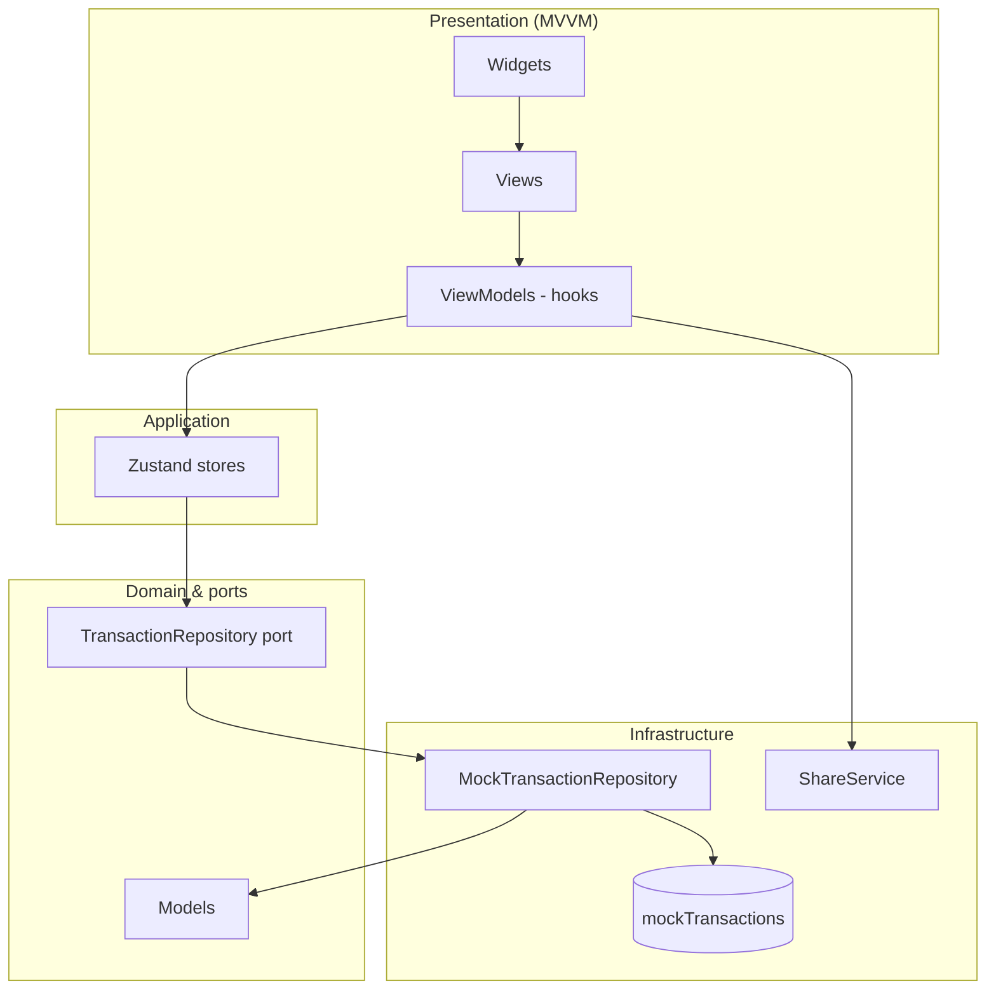

# AEON Bank Transactions

Mobile engineer assessment project: an Expo/React Native banking MVP for browsing, filtering, and sharing transaction history. The app uses mock backend data today, with architecture shaped for a future authenticated API and hardened production controls.

## Features

- **Transaction list** — Latest-first sorting; tap a row to open detail by `refId`.
- **Detail screen** — Full transfer metadata with formatted currency and dates.
- **Share** — Native share sheet via `ShareService`, with receipt text built from domain data and passed through `sanitizeSharePayload`.
- **Search & filters**
  - Debounced search (~300ms) across reference ID, recipient, transfer name, and amount.
  - Type chips: all / incoming / outgoing.
  - Date range chips: all / last 7 days / last 30 days.
- **Locales** — English (`en`) and Bahasa Malaysia (`bm`) via the `t()` helper; language toggle on the list screen.
- **Theme** — Light, dark, and system appearance using design tokens; theme toggle on the list screen.
- **Pull-to-refresh** — Reload transactions from the repository on the list screen.
- **UI states** — Loading spinner, empty list, full-screen error with retry, and “no matching results” when filters exclude all rows.

## Setup & Run

### Prerequisites

- **Node.js** — Use an active **LTS** release (**Node 20+** recommended for Expo SDK 57). Older Node versions may fail during install or Metro bundling.
- **iOS** — Xcode and Simulator (macOS), or Expo Go on a device.
- **Android** — Android Studio / emulator, or Expo Go on a device.

### Install and start

```bash
npm install
npm start
```

From the Expo dev tools (or separate terminals):

```bash
npm run ios      # expo start --ios
npm run android  # expo start --android
```

Optional quality checks (also used in CI):

```bash
npx expo lint
npx tsc --noEmit
```

## Testing

### Unit, mock, and component tests (Jest)

```bash
npm test
```

Coverage in this repo includes:

| Layer | Examples |
|-------|----------|
| **Unit** | `src/utils/` (sort, filter, format, amount color), `src/i18n/`, `src/theme/` |
| **Mock / boundary** | `MockTransactionRepository`, `transactionStore` with injectable repository |
| **Security** | `SecureLogger`, `sanitizeSharePayload` |
| **Component (RNTL)** | Widgets such as `TransactionCard`, `AmountText`, `ThemeProvider` |

Jest uses the `jest-expo` preset and the `@/` → `src/` path alias (see `package.json`).

### End-to-end (Detox)

Detox is the intended smoke path: **list → search/filter → detail → share**. It is **not** run in the default CI job until the suite is stable.

Detox requires a **native project** (Expo prebuild) and a **booted simulator/emulator**:

```bash
npx expo prebuild
# After Detox is configured (detox.config.js + native build scripts):
detox build --configuration ios.sim.debug
detox test --configuration ios.sim.debug
```

Use stable `testID`s (e.g. `transaction-list`, `search-input`, `filter-type-*`, `filter-date-*`, `transaction-card-{refId}`, `share-button`, `theme-toggle`, `language-toggle`) for reliable E2E selectors.

### Continuous integration

CI is expected to gate merges on:

```bash
npx expo lint
npx tsc --noEmit
npm test
```

Detox can be added as a separate workflow step once prebuild artifacts and simulator runners are wired and flaky tests are addressed.

## Architecture

This codebase combines **Clean Architecture** (ports and adapters, testable domain) with **MVVM** (natural fit for React Native: screens as Views, hooks as ViewModels).

### Dependency rule

Dependencies point **inward**. UI must not reach around the store into repositories or raw mock JSON.

```text
views / widgets  →  viewmodels  →  store  →  repositories  →  data
```

| Layer | Role |
|-------|------|
| **Views / widgets** | Compose UI; widgets stay presentational with typed props. |
| **ViewModels** | Custom hooks: filter state, navigation, labels, share intents. |
| **Store** | Zustand: loading/error/data; calls the repository port. |
| **Repositories** | `TransactionRepository` interface; `MockTransactionRepository` adapter today. |
| **Data** | Mock DTO payloads (`src/data/`) mapped to domain models. |

**Why Clean Architecture?** The repository **port** lets you swap `MockTransactionRepository` for an authenticated HTTP adapter without rewriting screens. Domain models and pure utils stay free of React and Zustand.

**Why MVVM?** React Native screens map cleanly to **Views**, and **`useTransactionListViewModel` / `useTransactionDetailViewModel`** act as **ViewModels**—colocated state and commands without bloating JSX.

### Diagram



### `src/` layout

```text
src/
├── data/                 # Mock backend payloads (DTO-shaped)
├── hooks/                # Shared hooks (e.g. debounce)
├── i18n/                 # en / bm dictionaries and t()
├── models/               # Domain types (Transaction, filters)
├── navigation/           # React Navigation stack
├── presentation/
│   ├── views/            # Screens (list, detail)
│   ├── viewmodels/       # use*ViewModel hooks
│   └── widgets/          # Reusable UI (cards, filters, states)
├── repositories/         # Port + mock adapter + DTO mapping
├── security/             # SecureLogger, share sanitization, SecureStore wrapper
├── services/             # Native-facing services (share)
├── store/                # Zustand (transactions, preferences)
├── theme/                # Tokens, ThemeProvider, light/dark/system
└── utils/                # Pure helpers (sort, filter, format)
```

Entry point: root `App.tsx` (React Navigation), registered from `index.ts`. Path alias `@/` maps to `src/` (see `tsconfig.json`).

## Security notes

Banking MVP conventions applied in code:

- **`SecureLogger`** — Outside `__DEV__`, log arguments are passed through `redactPiiValue` so reference IDs, amounts, recipient names, and similar fields are not emitted to console in production-like builds.
- **`sanitizeSharePayload`** — Strips control characters and caps title/message length before `Share.share()`; receipt lines are built via `sanitizeSharePayloadForTransaction`.
- **`secureStorage`** — Thin wrapper around **expo-secure-store** for **future** tokens and secrets (not used for language/theme today).
- **Preferences** — Language and theme mode persist in **AsyncStorage** via Zustand `persist` (`preferencesStore`).
- **Secrets** — No API keys or credentials in the client bundle; do **not** use `EXPO_PUBLIC_*` for secrets. Authenticated API access should live behind a server or secure native storage when integrated.

## Tech stack

| Area | Choice |
|------|--------|
| Framework | Expo ~57, React Native 0.86, React 19 |
| Language | TypeScript (strict) |
| Navigation | `@react-navigation/native` + native stack |
| State | Zustand (+ persist for preferences) |
| Storage | AsyncStorage (prefs), expo-secure-store (future secrets) |
| i18n | Lightweight dictionary + `t(key, locale)` |
| Theming | Context + semantic color/spacing/typography tokens |
| Testing | Jest (`jest-expo`), React Native Testing Library; Detox planned for E2E |
| Lint | ESLint (`eslint-config-expo`) |

## Future improvements

- Real API integration with an **authenticated** `TransactionRepository` implementation
- **Biometric / PIN** app lock before showing transaction data
- **PDF receipt** generation before share (in addition to plain-text receipts)
- **Offline sync** and explicit **cache invalidation** strategy
- **Certificate pinning** / hardened network layer for production API traffic
- **Exact custom date-range picker** (beyond preset 7d / 30d chips)
- **Additional locales** beyond English and Bahasa Malaysia
- **Accessibility audit** (labels, contrast, screen reader flows, focus order)
- **Detox suite expansion** and **CI gating** once E2E is stable on simulators
- **Analytics** with PII-safe event payloads (no raw ref IDs or account identifiers in event properties)

---

Built as an AEON Bank mobile engineer assessment: production-minded structure and security hooks on mock data, ready to evolve toward a live banking backend.
